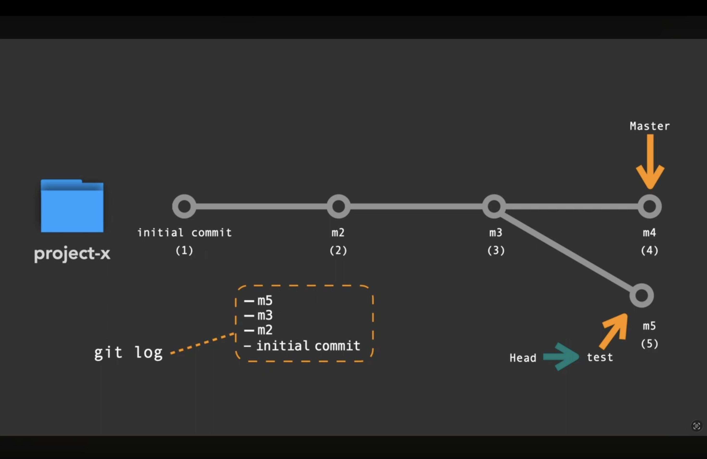
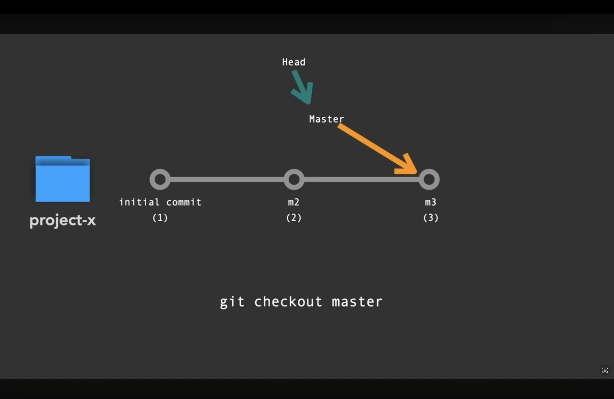

# مرجع Git العملي

دليل سريع ومنظم لأوامر Git الأساسية: من إنشاء المستودع وتجهيز الملفات، إلى حفظ التعديلات والعمل بالفروع والتعامل مع GitHub. استبدل أسماء الملفات والفروع والقيم بين `< >` بالقيم المناسبة لمشروعك.

> **ملاحظة:** أمثلة النتائج توضيحية؛ قد تختلف التفاصيل مثل أسماء الملفات، وعدد التعديلات، ومعرّفات الـ commits من مشروع لآخر.

## المحتويات

- [بدء المستودع ومراجعة حالته](#بدء-المستودع-ومراجعة-حالته)
- [تجهيز التعديلات وحفظها](#تجهيز-التعديلات-وحفظها)
- [مراجعة سجل التغييرات والتنقل](#مراجعة-سجل-التغييرات-والتنقل)
- [العمل بالفروع](#العمل-بالفروع)
- [الربط مع GitHub ومزامنة التغييرات](#الربط-مع-github-ومزامنة-التغييرات)
- [التراجع عن التغييرات](#التراجع-عن-التغييرات)
- [اختصار سجل Git](#اختصار-سجل-git)

## بدء المستودع ومراجعة حالته

### `git init` — إنشاء مستودع Git

يبدأ تتبّع مجلد المشروع بواسطة Git. شغّله من داخل المجلد الذي تريد إدارته.

**مثال على الناتج:**

```text
Initialized empty Git repository in /path/to/project/.git/
```

### `git status` — عرض حالة الملفات

يوضح الفرع الحالي والملفات الجديدة أو المعدّلة أو المجهزة للحفظ.

**مثال على الناتج:**

```text
On branch main
Changes not staged for commit:
  modified:   README.md
```

### `git status -s` — عرض مختصر للحالة

يعرض حالة الملفات في سطور مختصرة؛ مثلًا `M` تعني ملفًا معدّلًا و`??` تعني ملفًا جديدًا غير متتبّع.

**مثال على الناتج:**

```text
 M README.md
?? notes.txt
```

## تجهيز التعديلات وحفظها

### `git add <file>` — تجهيز ملف محدد

ينقل تغييرات الملف إلى منطقة التجهيز (staging)، لتكون ضمن الـ commit التالي.

```bash
git add README.md index.html
```

**مثال على الناتج:** لا يطبع الأمر عادةً أي شيء عند النجاح. يمكنك التأكد باستخدام `git status`:

```text
Changes to be committed:
  modified:   README.md
  modified:   index.html
```

### `git add .` — تجهيز التغييرات في المجلد الحالي

يجهز الملفات الجديدة والمعدّلة والمحذوفة داخل المجلد الحالي ومجلداته الفرعية. راجع الحالة قبل الحفظ للتأكد مما أُضيف.

**مثال على الناتج:** لا يطبع الأمر عادةً أي شيء عند النجاح؛ وقد يعرض `git status -s`:

```text
M  README.md
A  notes.txt
```

### `git add *` — تجهيز المسارات التي يطابقها الـ shell

يوسّع الـ shell الرمز `*` إلى أسماء الملفات والمجلدات الظاهرة في المجلد الحالي قبل تمريرها إلى Git. قد لا يشمل الملفات المخفية؛ لذلك `git add .` أو تحديد الملفات مباشرةً أوضح في أغلب الحالات.

**مثال على الناتج:** لا يطبع الأمر عادةً أي شيء عند النجاح. راجع الملفات التي جهزها باستخدام `git status`.

### `git commit -m "<message>"` — حفظ التعديلات المجهزة

ينشئ commit من التغييرات التي جهزتها باستخدام `git add`. اكتب رسالة قصيرة تصف التغيير.

```bash
git commit -m "Update Git command reference"
```

**مثال على الناتج:**

```text
[main a1b2c3d] Update Git command reference
 1 file changed, 12 insertions(+)
```

### `git commit -am "<message>"` — تجهيز وحفظ تعديلات الملفات المتتبّعة

يجهز التعديلات والحذف في الملفات التي يتتبعها Git بالفعل ثم يحفظها. **لا يضيف الملفات الجديدة غير المتتبّعة**؛ استخدم `git add` لها أولًا.

```bash
git commit -am "Fix page title"
```

**مثال على الناتج:**

```text
[main d4e5f6a] Fix page title
 1 file changed, 1 insertion(+), 1 deletion(-)
```

## مراجعة سجل التغييرات والتنقل

### `git log` — عرض سجل الـ commits

يعرض سجل التغييرات، معرّف كل commit ورسالة الحفظ وصاحبه وتاريخه.

**مثال على الناتج:**

```text
commit a1b2c3d...
Author: Your Name
Date:   ...

    Update Git command reference
```

### `git checkout <commit-hash>` — الانتقال إلى commit سابق

يعرض حالة المشروع عند commit محدد. عند الانتقال مباشرةً إلى معرّف commit، ستكون في حالة **Detached HEAD**؛ أي إنك لست على فرع. للعودة، انتقل إلى فرع مثل `main`.

```bash
git checkout a1b2c3d
```

**مثال على الناتج:**

```text
Note: switching to 'a1b2c3d'.
You are in 'detached HEAD' state.
```

### `git rm --cached <file>` — إيقاف تتبّع ملف مع إبقائه محليًا

يزيل الملف من الفهرس الذي يتتبعه Git، لكنه **لا يحذفه من جهازك**. مفيد عند إضافة ملف إلى `.gitignore` بعد أن كان Git يتتبعه.

```bash
git rm --cached hello.html
```

**مثال على الناتج:**

```text
rm 'hello.html'
```

## العمل بالفروع

### `git branch` — عرض الفروع

يعرض الفروع المحلية، وتظهر علامة `*` بجانب الفرع الحالي.

**مثال على الناتج:**

```text
  dev
* main
```

### `git branch -M main` — إعادة تسمية الفرع الحالي

يعيد تسمية الفرع الحالي إلى `main`. الخيار `-M` يسمح باستبدال فرع محلي بالاسم نفسه إذا لزم الأمر.

**مثال على الناتج:** لا يطبع الأمر عادةً أي شيء عند النجاح. تحقق من الاسم الجديد باستخدام `git branch`.

### `git branch <branch-name>` — إنشاء فرع جديد

ينشئ فرعًا جديدًا **من دون الانتقال إليه**.

```bash
git branch dev
```

**مثال على الناتج:** لا يطبع الأمر عادةً أي شيء عند النجاح. سيظهر `dev` في قائمة `git branch`.

### `git checkout -b <branch-name>` — إنشاء فرع والانتقال إليه

ينشئ الفرع الجديد انطلاقًا من الفرع الحالي، ثم ينقلك إليه مباشرةً.

```bash
git checkout -b dev
```

**مثال على الناتج:**

```text
Switched to a new branch 'dev'
```

> `git branch -b dev` ليس أمرًا صالحًا لإنشاء فرع. استخدم `git checkout -b dev`.

### `git checkout <branch-name>` — الانتقال إلى فرع

ينقل العمل إلى فرع موجود. استخدم اسم الفرع الذي يظهر في قائمة `git branch`؛ مثل `main` أو `master`.

```bash
git checkout main
```

**مثال على الناتج:**

```text
Switched to branch 'main'
```

### `git merge <branch-name>` — دمج فرع في الفرع الحالي

يدمج تغييرات الفرع المحدد في **الفرع الذي تقف عليه حاليًا**. للدمج في `main`، انتقل إليه أولًا ثم نفّذ الدمج.

```bash
git checkout main
git merge dev
```

**مثال على الناتج عند نجاح الدمج:**

```text
Updating a1b2c3d..d4e5f6a
Fast-forward
 README.md | 12 ++++++++++++
 1 file changed, 12 insertions(+)
```

### `git branch -d <branch-name>` — حذف فرع محلي مدموج

يحذف الفرع المحلي بعد دمجه. يرفض Git عادةً حذف فرع يحتوي على تغييرات غير مدموجة.

```bash
git branch -d dev
```

**مثال على الناتج:**

```text
Deleted branch dev (was d4e5f6a).
```

### فهم شكل الفروع

يوضح الرسم كيف يمكن للفرع أن يتقدم عبر commits بينما يشير `HEAD` إلى موضع العمل الحالي:



ويوضح الرسم التالي الانتقال إلى `master`، وهو الاسم الذي كان شائعًا للفرع الرئيسي قبل استخدام `main` على نطاق واسع:



## الربط مع GitHub ومزامنة التغييرات

### `git remote add origin <repository-url>` — ربط المشروع بمستودع بعيد

يسجل عنوان المستودع البعيد باسم مختصر هو `origin`. نفّذ الأمر مرة واحدة لكل مستودع محلي.

```bash
git remote add origin https://github.com/Ahmed9030/Git.git
```

**مثال على الناتج:** لا يطبع الأمر عادةً أي شيء عند النجاح.

### `git push -u origin main` — رفع الفرع إلى GitHub

يرفع فرع `main` إلى المستودع البعيد `origin`. يضبط الخيار `-u` علاقة التتبع، لتسهيل استخدام `git push` و`git pull` لاحقًا.

```bash
git push -u origin main
```

**مثال على الناتج:**

```text
To https://github.com/Ahmed9030/Git.git
 * [new branch]      main -> main
branch 'main' set up to track 'origin/main'.
```

### `git fetch` — جلب معلومات التغييرات البعيدة

يجلب commits والفروع الجديدة من المستودع البعيد، **من دون دمجها تلقائيًا** في فرعك الحالي.

**مثال على الناتج:**

```text
From https://github.com/Ahmed9030/Git
   a1b2c3d..d4e5f6a  main -> origin/main
```

### `git pull origin main --no-rebase` — جلب تغييرات `main` ودمجها

يجلب التغييرات من `main` في المستودع `origin` ويدمجها في الفرع الحالي باستخدام merge بدلًا من rebase. تأكد من الفرع الحالي قبل التنفيذ.

**مثال على الناتج عند وجود تحديثات:**

```text
From https://github.com/Ahmed9030/Git
 * branch            main       -> FETCH_HEAD
Updating a1b2c3d..d4e5f6a
Fast-forward
 README.md | 3 +++
 1 file changed, 3 insertions(+)
```

### `git diff [file-name]` — عرض التغييرات غير المجهزة

يعرض الفرق بين ملفات العمل ومنطقة التجهيز، أي التعديلات التي لم تجهزها بعد للحفظ. أضف اسم ملف لمراجعة ملف بعينه.

```bash
git diff
git diff README.md
```

**مثال على الناتج:**

```diff
-عنوان قديم
+عنوان جديد
```

## التراجع عن التغييرات

### `git reset --soft HEAD~1` — إلغاء آخر commit مع الاحتفاظ بالتغييرات مجهزة

يحرك الفرع خطوة إلى الخلف ويلغي آخر commit، لكنه يُبقي تعديلاته في منطقة التجهيز لتتمكن من إنشاء commit جديد.

**مثال على الناتج:** لا يطبع الأمر عادةً أي شيء عند النجاح. بعده، يعرض `git status` الملفات كتغييرات مجهزة.

### `git reset --hard HEAD~1` — إلغاء آخر commit والتغييرات المرتبطة به

يحرك الفرع خطوة إلى الخلف ويعيد ملفات العمل إلى الحالة الناتجة. قد يؤدي ذلك إلى **فقدان تغييرات محلية غير محفوظة**؛ لا تستخدمه إلا بعد التأكد من أنك لا تحتاج هذه التغييرات.

**مثال على الناتج:** لا يطبع الأمر عادةً أي شيء عند النجاح. استخدم `git status` لمراجعة الحالة بعد التنفيذ.

## اختصار سجل Git

### `git config --global alias.lg "<format>"` — إنشاء الأمر المختصر `git lg`

يحفظ اختصارًا عامًا باسم `lg` لعرض السجل كرسم نصي ملوّن، مع معرّف commit المختصر والفرع والرسالة والوقت واسم الكاتب.

```bash
git config --global alias.lg "log --color --graph --pretty=format:'%Cred%h%Creset -%C(auto)%d%Creset %s %Cgreen(%cr) %C(bold blue)<%an>%Creset' --abbrev-commit"
```

بعدها استخدم:

```bash
git lg
```

**مثال على الناتج:**

```text
* a1b2c3d (HEAD -> main) Update Git command reference (2 minutes ago) <Your Name>
* 9f8e7d6 Initial commit (1 day ago) <Your Name>
```
